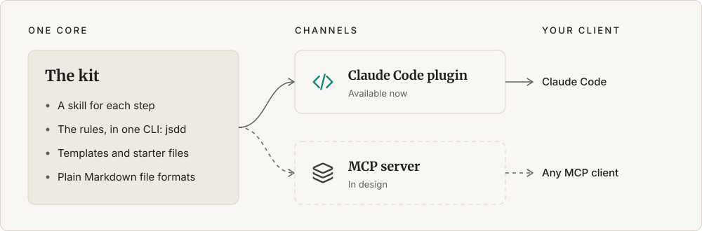

<picture>
  <source media="(prefers-color-scheme: dark)" srcset="assets/banner-dark.svg">
  
</picture>

Every piece of work starts as a written spec that you approve one step at a time, with checks
the agent can't skip and a board that shows what to do next.

### Products

<a href="https://github.com/JoDi-SDD/JoDi-SDD">
  <picture>
    <source media="(prefers-color-scheme: dark)" srcset="assets/card-claude-code-dark.svg">
    
  </picture>
</a>

<a href="https://github.com/JoDi-SDD/jsdd-mcp">
  <picture>
    <source media="(prefers-color-scheme: dark)" srcset="assets/card-mcp-dark.svg">
    
  </picture>
</a>

### One core, many channels

<picture>
  <source media="(prefers-color-scheme: dark)" srcset="assets/channels-dark.svg">
  
</picture>

The rules live in one place, the kit. Each channel delivers the same specs and the same checks
to a different client.

### Start here

[What it does](https://github.com/JoDi-SDD/JoDi-SDD#what-you-get) ·
[Install](https://github.com/JoDi-SDD/JoDi-SDD#install) ·
[Quick start](https://github.com/JoDi-SDD/JoDi-SDD#quick-start) ·
[Contribute](https://github.com/JoDi-SDD/JoDi-SDD/blob/main/CONTRIBUTING.md)

### Follow along

- **Announcements:** [org discussions](https://github.com/orgs/JoDi-SDD/discussions)
- **Releases:** [JoDi-SDD releases](https://github.com/JoDi-SDD/JoDi-SDD/releases)
- **What's planned:** [Roadmap](https://github.com/JoDi-SDD/JoDi-SDD/blob/main/ROADMAP.md)
- **Questions and bugs:** [open an issue](https://github.com/JoDi-SDD/JoDi-SDD/issues)
